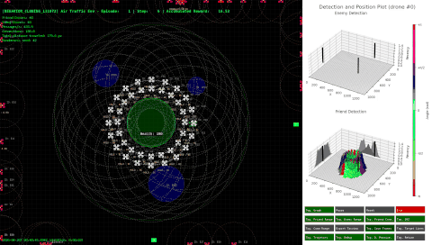

# Aprendizado por Imitação para Otimização de Comportamento Defensivo em Enxames de Drones Autônomos

> Trabalho Mestrado — Instituto Tecnológico de Aeronáutica (ITA)  
> Autor: Lucas Lima  
> Programa: Engenharia Eletrônica e Computação

---

## Visão Geral



Este repositório contém o código desenvolvido para a dissertação de mestrado, que investiga a aplicação de **Aprendizado por Imitação (Imitation Learning — IL)** via **Clonagem Comportamental (Behavior Cloning — BC)** para otimização do comportamento defensivo de enxames de drones autônomos durante o estado operacional predominante: `HOLD-WAIT`.

O trabalho é continuação direta do Trabalho de Graduação (TG), que desenvolveu o simulador [DroneSwarm2D](https://github.com/lucasll37/DroneSwarm2D-lib) e identificou o `HOLD-WAIT` como estado responsável por aproximadamente 80% do tempo operacional dos drones defensivos — permanecendo estacionário nessa versão original. A hipótese central é que demonstrações humanas podem ensinar comportamentos de vigilância ativa nesse estado, resultando em maior efetividade defensiva.

---

## Problema e Motivação

O algoritmo distribuído baseado em Máquina de Estados Finitos (FSM) estabelecido no TG apresenta limitação fundamental: durante o estado `HOLD-WAIT`, os drones permanecem estáticos em posições fixas ao redor da área de interesse. Essa estratégia, embora superior às alternativas avaliadas no TG, deixa inexplorada a oportunidade de reposicionamento tático proativo durante o tempo de espera.

Técnicas de Aprendizado por Reforço (RL) enfrentam desafios práticos nesse domínio (engenharia de funções de recompensa, necessidade de grandes volumes de interações, instabilidade de treinamento). BC oferece alternativa: aprender diretamente de demonstrações de operadores humanos, sem necessidade de especificar recompensas explícitas.

---

## Abordagem

### Coleta de Demonstrações (*Human-in-the-Loop*)

- Controle manual via joystick **DualSense (PS5)** integrado ao simulador DroneSwarm2D
- Sempre que um drone entra em `HOLD-WAIT`, seu controle é transferido ao operador humano
- Cada amostra registra: `pos` (posição do drone), `friends_hold` (matriz de aliados em holding), `velocity` (ação executada)
- Dados armazenados em formato JSONL

Três datasets foram gerados com progressão geométrica para investigar o impacto do volume de dados:

| Dataset | Amostras |
|---------|----------|
| Pequeno | 8.192    |
| Médio   | 32.768   |
| Grande  | 131.072  |

### Representação de Estado

O estado observável pelo modelo é composto por:

1. **`pos`** — vetor bidimensional com as coordenadas cartesianas do drone, normalizadas pelo tamanho da grade
2. **`friends_hold`** — matriz 2D indicando presença e intensidade de drones aliados em estado `HOLD` por célula da grade de discretização espacial

A estrutura bidimensional de `friends_hold` motivou a investigação de arquiteturas convolucionais (CNN) como alternativa às redes totalmente conectadas (MLP).

### Arquiteturas Investigadas

Foram avaliadas múltiplas combinações de:
- **Tipo de rede:** CNN vs. MLP
- **Otimizador:** Adam, SGD, RMSprop
- **Função de ativação:** ReLU, tanh
- **Profundidade e largura das camadas**

A função de perda utilizada é a **similaridade de cosseno** (entre vetor de velocidade predito e demonstrado).

### Duplo *Baseline*

A metodologia emprega dois comportamentos de referência para isolar a origem dos ganhos:

- **Heurístico** — comportamento estacionário do TG (referência de desempenho)
- **Aleatório** — movimentação aleatória durante `HOLD-WAIT` (controle metodológico)

Se BC supera apenas o heurístico, o benefício pode ser atribuído à mera mobilidade. Se supera ambos, há evidência de aprendizado efetivo de padrões táticos a partir das demonstrações.

---

## Resultados Principais

### Arquitetura Vencedora

**CNN com 3 camadas convolucionais + 2 camadas densas, otimizador Adam, ativação ReLU**, treinada com 131.072 amostras (`val_loss` = 0,0831).

CNNs ocuparam 8 das 10 melhores posições no ranqueamento de modelos, consistente com a hipótese de que `friends_hold` apresenta estrutura espacial aproveitável por filtros convolucionais.

### Efetividade Defensiva (SPI)

| Comportamento     | SPI Médio (%) | ICE Médio | Eficiência (SPI/ICE × 10³) |
|-------------------|---------------|-----------|--------------------------|
| Heurístico (TG)   | 78,5          | 2.847     | 27,57                    |
| Aleatório         | 78,7          | 32.140    | 2,45                     |
| BC 8K             | 77,9          | 29.873    | 2,61                     |
| BC 32K            | 87,3          | 3.124     | 27,94                    |
| BC 131K           | 91,2          | 3.681     | 24,78                    |

- **BC 32K**: melhor eficiência global (SPI/ICE), superando o heurístico em efetividade (+11,2%) e eficiência energética relativa (+1,3%)
- **BC 131K**: maior efetividade absoluta (+16,2% em SPI), com custo energético proporcionalmente maior

### Alteração do Perfil Operacional

Com BC, o tempo em `HOLD-WAIT` caiu de ~80% para **68,5%**, com redistribuição para estados táticos ativos:

| Estado          | Heurístico | BC 131K |
|-----------------|------------|---------|
| `HOLD-WAIT`     | ~80,0%     | 68,5%   |
| `PURSUING`      | ~12,5%     | 18,9%   |
| `HOLD-INTCPT`   | ~4,2%      | 7,8%    |

### Volume de Dados

- Redução de **44,8%** na perda de validação ao quadruplicar de 8.192 para 32.768 amostras
- Redução adicional de **8,7%** ao quadruplicar para 131.072 amostras (retornos decrescentes)

### Validação Metodológica

Os *baselines* Heurístico e Aleatório apresentaram equivalência estatística (ICs *bootstrapped* de 95% sobrepostos em SPI e ICE), confirmando que os ganhos do BC estão associados ao aprendizado de padrões táticos — e não à mera introdução de movimentação durante `HOLD-WAIT`.

---

## Estrutura do Repositório

```
.
├── analysis/
│   ├── data/                     # CSVs de resultados por cenário (200 episódios cada)
│   ├── images/                   # Figuras geradas pelos notebooks
│   ├── compare.ipynb             # Análise estatística (violinos, bootstrap, heatmaps)
│   ├── compare_en.ipynb          # Versão em inglês da análise
│   └── main.py                   # Executa episódios de avaliação e salva CSV
├── config/
│   ├── behavior_cloning_131072.json  # Configuração usada pelos pontos de entrada
│   └── preset/                   # Cenários (benchmark, greedy, centralized, proposal, BC, ...)
├── src/
│   ├── imitation_learning/
│   │   ├── data/                 # Demonstrações (joystick_data/), datasets TF e históricos de treino
│   │   ├── images/               # Curvas de perda e diagrama da arquitetura
│   │   ├── models/               # Modelos treinados (.keras)
│   │   ├── behaviors.py          # Comportamentos BC (FriendCommonBehaviorAI) e Aleatório (FriendBenchmarkBehavior)
│   │   ├── data.py               # Conversão JSONL → tf.data.Dataset, carregamento e split
│   │   ├── gridsearch.py         # Busca em grade de hiperparâmetros
│   │   ├── heuristic_data.py     # Geração de dataset a partir do comportamento heurístico
│   │   ├── inspectData.py        # Inspeção dos datasets
│   │   ├── main.py               # Ponto de entrada da simulação (modo BC / coleta via joystick)
│   │   ├── test.py               # Avaliação dos modelos treinados
│   │   └── train.py              # Treinamento do modelo final
│   └── planning/
│       ├── behaviors.py          # Comportamento heurístico (baseline do TG)
│       └── main.py               # Ponto de entrada da simulação (modo heurístico)
├── tools/
│   ├── compare.py                # Funções estatísticas e de plot usadas nos notebooks
│   ├── fsm.py                    # Diagrama da máquina de estados
│   ├── create_video.py, create_gif.py, merge_video.py, merge_gif.py
│   ├── view_enemy_behavior.py, view_multi_enemy_behavior.py
│   └── utils.py                  # Utilitários (carregamento do melhor modelo, etc.)
├── Makefile
├── requirements.txt
└── README.md
```

> O framework **DroneSwarm2D** (simulador, FSM, infraestrutura de comunicação entre drones) possui repositório próprio: [DroneSwarm2D-lib](https://github.com/lucasll37/DroneSwarm2D-lib). Ele é instalado automaticamente via `requirements.txt`.

---

## Instalação e Uso

### Pré-requisitos

- Linux com Python 3.12 (`python3.12` e `python3.12-venv`)
- `make`
- Joystick DualSense (PS5) — apenas para coleta de demonstrações

### Configuração do Ambiente

```bash
# Dependências de sistema (apt, requer sudo) — só na primeira vez
make apt_deps

# Cria o venv em ./.venv e instala o requirements.txt
make create_env

# (opcional) ativar o venv para usar o Python interativamente
source .venv/bin/activate
```

Os alvos do `Makefile` já usam o Python do `.venv` e colocam a raiz do projeto no `PYTHONPATH`, então não é necessário ativar o ambiente para rodá-los. Para ver todos os alvos disponíveis:

```bash
make help
```

### Executar

Os comandos devem ser rodados a partir da raiz do repositório.

```bash
# Simulação com o comportamento heurístico (baseline do TG)
make run

# Simulação com o comportamento BC (carrega o modelo com menor val_loss em src/imitation_learning/models/)
make ai

# Treinamento do modelo BC
make train

# Avaliação em lote (ANALYSIS_EPISODES episódios) → analysis/data/<cenário>/results_<timestamp>.csv
# O comportamento avaliado é escolhido pelo import em analysis/main.py
make analysis
```

A configuração usada por cada ponto de entrada é definida na chamada `DroneSwarm2D.init(config_path=...)` no início do respectivo `main.py`; os cenários prontos estão em `config/preset/`.

### Coleta de Demonstrações

1. Conecte o DualSense e defina `"JOYSTICK": "Friend"` no arquivo de configuração usado por `src/imitation_learning/main.py`.
2. Mantenha `save_joystick_data=True` na criação de `FriendCommonBehaviorAI` em `src/imitation_learning/main.py`.
3. Rode `make ai`. As amostras são gravadas em `src/imitation_learning/data/joystick_data/joystick_session_<timestamp>.jsonl`.
4. Converta o JSONL em `tf.data.Dataset` com `src/imitation_learning/data.py` (ajuste `jsonl_path` e `save_path` no bloco `__main__`).

---

## Métricas

| Métrica | Descrição |
|---------|-----------|
| **SPI** (*Saúde do Ponto de Interesse*) | Saúde remanescente da área protegida ao final da simulação. Valores mais altos indicam maior efetividade defensiva. |
| **ICE** (*Índice de Consumo de Energia*) | Consumo energético agregado do enxame defensivo. |

---

## Limitações

- Ambiente simulado 2D — não captura dinâmicas de altitude de cenários reais
- Demonstrações coletadas por operador único — possível incorporação de vieses individuais
- Modelo estático após treinamento — sem adaptação a ameaças emergentes
- Pressupõe distribuição i.i.d. entre dados de treino e teste

---

## Trabalhos Futuros

- *Ablation study* sobre a representação de estado (contribuição relativa de `pos` vs. `friends_hold`)
- Coleta de demonstrações de múltiplos operadores
- Análise de sensibilidade paramétrica (raio de comunicação, velocidade, dimensões da DMZ)
- Migração para simulação tridimensional

---

## Referências

- **TG (trabalho base):** [LIMA, L. *DroneSwarm2D: Simulação de Enxames de Drones para Defesa Distribuída*. ITA, 2025](http://www.bdita.bibl.ita.br/TGsDigitais/lista_resumo.php?num_tg=80699).
- **Framework:** [github.com/lucasll37/DroneSwarm2D-lib](https://github.com/lucasll37/DroneSwarm2D-lib)